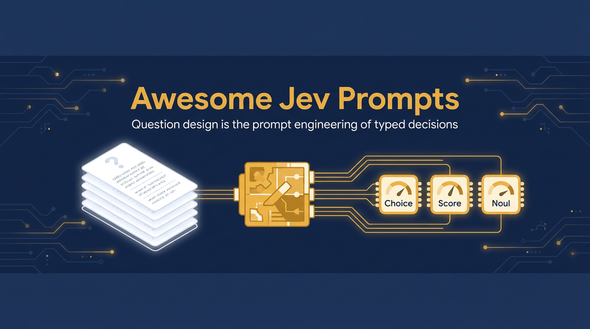
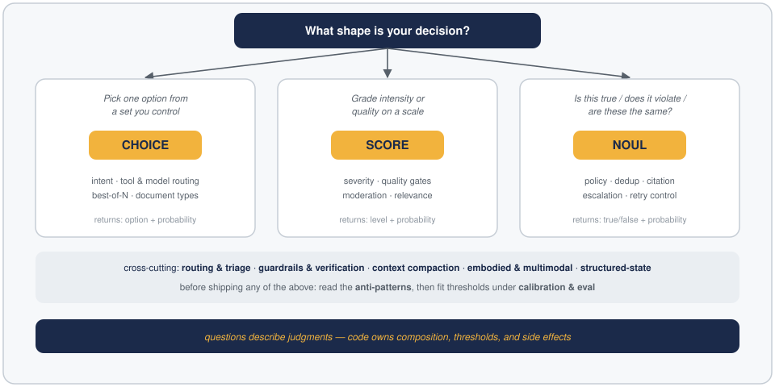
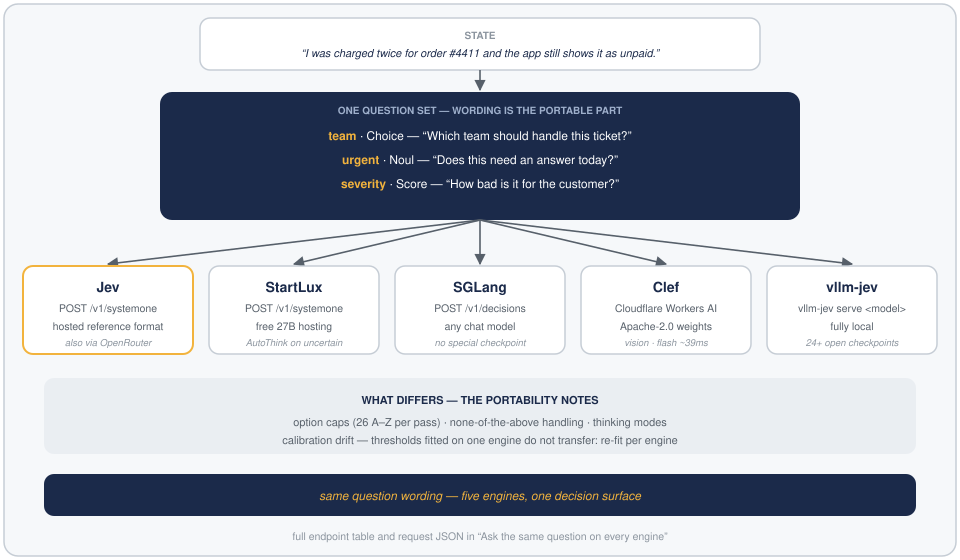

# Awesome Jev Prompts

> A curated library of question patterns, anti-patterns, and calibration notes for typed decision models — [Jev](https://typesafe.ai/blog/introducing-system-one-models-and-jev) and every System One-compatible engine (Clef, StartLux, d3, SGLang `/v1/decisions`, any `/v1/systemone` endpoint). **Question design is the prompt engineering of typed decisions — and question wording is the portable part.**

[](https://github.com/vicfei/awesome-jev-prompts/stargazers)
[](https://github.com/vicfei/awesome-jev-prompts/commits)
[](https://github.com/vicfei/awesome-jev-prompts/actions/workflows/link-check.yml)
[](https://github.com/vicfei/awesome-jev-prompts/actions/workflows/tests.yml)
[](#license)

**中文版（含全部 51 条中文译本）在[这里](README.zh-CN.md)。**

Jev returns typed answers — **Choice**, **Score**, **Noul** — with probabilities, in 70–500 ms. It never writes text, so none of your prompt-engineering habits transfer. What transfers instead is **question design**: how you split a decision into atomic judgments, how you word option descriptions, where you set thresholds, and when you refuse to trust the number. This list collects the patterns that work — and the anti-patterns that quietly break production systems.


<p align="center">
  
</p>

## Contents

- [Leaderboard — every listed project by stars & weekly change](#leaderboard)
- [Lint your questions](#lint-your-questions)
- [Ask the same question on every engine](#ask-the-same-question-on-every-engine)
- [Benchmarks & datasets](#benchmarks--datasets)
- [which-jev — pick an engine by scenario](#which-jev--pick-an-engine-by-scenario)
- [Using this with the skills](#using-this-with-the-skills)
- [Ecosystem notes](#ecosystem-notes)
- [Official resources](#official-resources)
- [Related](#related)
- [Related lists](#related-lists)

## Leaderboard

<!-- leaderboard:start -->
Top 10 of the 68 GitHub projects this list references, by stars — the full ranking plus the weekly-change table live in [LEADERBOARD.md](LEADERBOARD.md).

| # | Project | Stars | Δ 7d |
|---|---|---:|---:|
| 1 | [TauricResearch/TradingAgents](https://github.com/TauricResearch/TradingAgents) | 123,062 | +826 |
| 2 | [virattt/ai-hedge-fund](https://github.com/virattt/ai-hedge-fund) | 64,744 | +96 |
| 3 | [HKUDS/Vibe-Trading](https://github.com/HKUDS/Vibe-Trading) | 38,485 | +382 |
| 4 | [vllm-project/semantic-router](https://github.com/vllm-project/semantic-router) | 6,503 | +45 |
| 5 | [typesafe-ai/skills](https://github.com/typesafe-ai/skills) | 2,906 | +12 |
| 6 | [yibie/awesome-jev](https://github.com/yibie/awesome-jev) | 2,611 | +31 |
| 7 | [StartLuxLabs/Startlux-Decision](https://github.com/StartLuxLabs/Startlux-Decision) | 1,771 | +34 |
| 8 | [heyjunpenn/awesome-jev](https://github.com/heyjunpenn/awesome-jev) | 1,081 | +10 |
| 9 | [mode-io/vllm-jev](https://github.com/mode-io/vllm-jev) | 955 | +1 |
| 10 | [Liuziyu77/Valen](https://github.com/Liuziyu77/Valen) | 926 | +13 |
<!-- leaderboard:end -->

## What is Jev?

A "System One" model (the fast-thinking reference is Kahneman's): unstructured state in, typed probabilistic decisions out. It gives up string generation for type-safe, calibrated outputs, which makes it two orders of magnitude faster and cheaper than chat models on judgment-shaped work.

| Primitive | You supply | You get back |
|---|---|---|
| **Choice** | `instructions` + `criteria` dict (option → description) | picked option, per-option `probabilities`, `confidence` |
| **Score** | `instructions` + `criteria` as an **ordered** rubric list | probability-weighted `score` (can land between levels), `legend`, `probabilities`, `confidence` |
| **Noul** | `instructions` | `noul`: probability the statement is true, 0–1 |

Quick facts (as of Jev 1.13 — verify against [docs](https://docs.typesafe.ai/models)):

| | |
|---|---|
| Endpoint | `POST https://api.typesafe.ai/v1/systemone` |
| Aliases / version | `jev-latest`, `jev-preview` → `jev-1.13.0` (aliases can move — pin when thresholds matter) |
| Pricing | $0.042 per 1M input tokens; output tokens free |
| Context | 64k tokens per request (32k state + longest question) |
| Limits | 250k tokens/sec; 1,200 requests/min |
| Modality | Text only (Jev proper) — multimodal System One variants exist, see [Ecosystem notes](#ecosystem-notes) |

## Quick start

```python
# python -m pip install typesafe-sdk
from typesafe_sdk import Choice, Noul, Score, TypeSafeClient

state = {
    "ticket": "I was charged twice and need the duplicate refunded today.",
    "account_tier": "business",
}

with TypeSafeClient() as client:
    response = client.system_one(
        state=state,
        questions={
            "intent": Choice(
                instructions="What is the customer's main request?",
                criteria={
                    "refund": "The customer wants money returned.",
                    "technical_help": "The customer needs a bug or integration fixed.",
                    "information": "The customer is asking for information only.",
                    "other": "None of the other options clearly fits.",
                },
            ),
            "is_urgent": Noul(
                instructions="Does the ticket explicitly communicate time pressure?",
            ),
            "frustration": Score(
                instructions="How frustrated does the customer appear?",
                criteria=[
                    "Calm and neutral",
                    "Concerned but civil",
                    "Very angry or using strong language",
                ],
            ),
        },
    )

print(response.answers["intent"].choice)
print(response.answers["intent"].probabilities)
print(response.answers["is_urgent"].noul)
print(response.answers["frustration"].score)
```

<details>
<summary>TypeScript equivalent</summary>

```ts
// npm install @typesafe-ai/sdk
import { choice, noul, score, TypeSafeClient } from "@typesafe-ai/sdk";

const client = new TypeSafeClient();
const result = await client.systemOne({
  state: { ticket: "I was charged twice and need the duplicate refunded today." },
  questions: {
    intent: choice("What is the customer's main request?", {
      refund: "The customer wants money returned.",
      technical_help: "The customer needs a bug or integration fixed.",
      information: "The customer is asking for information only.",
      other: "None of the other options clearly fits.",
    }),
    isUrgent: noul("Does the ticket explicitly communicate time pressure?"),
    frustration: score("How frustrated does the customer appear?", [
      "Calm and neutral",
      "Concerned but civil",
      "Very angry or using strong language",
    ]),
  },
});
```

</details>

*(Quick-start example adapted from [Anil-matcha/awesome-jev-by-typesafe](https://github.com/Anil-matcha/awesome-jev-by-typesafe), MIT.)*

## The library — 63 entries in 10 categories

Every entry gives the question template, threshold/wiring guidance, known failure modes, and sources.

| Category | Entries | What it covers |
|---|---|---|
| [Choice patterns](categories/choice-patterns.md) | 6 | Intent routing, tool selection, model routing, best-of-N, document types, skill routing |
| [Score patterns](categories/score-patterns.md) | 5 | Severity, quality gates, moderation, RAG relevance, priority queues |
| [Noul patterns](categories/noul-patterns.md) | 5 | Policy checks, dedup, citation checks, escalation, retry control |
| [Routing & triage](categories/routing-and-triage.md) | 4 | Inbox triage, ticket queues, RAG filtering, document streams |
| [Guardrails & verification](categories/guardrails-and-verification.md) | 5 | Output guardrails, jailbreak detection, validation, review gates |
| [Context compaction](categories/context-compaction.md) | 3 | Keep-or-drop, summarize-or-quote, tool-result pruning |
| [Anti-patterns](categories/anti-patterns.md) | 10 | The ten ways Jev questions go wrong, with fixes |
| [Calibration & eval](categories/calibration-and-eval.md) | 5 | Thresholds from logs, versioned questions, shadow mode, System Two handoff |
| [Embodied & multimodal](categories/embodied-multimodal-patterns.md) |
| [Structured-state patterns](categories/structured-state-patterns.md) | When your state is a table: tabular FM routing, column semantics, cross-paradigm calibration | 3 | 8 | Consult gating, capability sheets, mission contracts, multimodal state binding, per-axis control |

**The one rule that generates most of the others:** *questions describe judgments; code owns composition, thresholds, and side effects.*

## Which pattern do I need?

<p align="center">
  
</p>

- **Picking one option from a set you control** → [Choice patterns](categories/choice-patterns.md) — intent, tool, model routing, best-of-N
- **Grading intensity or quality on a scale** → [Score patterns](categories/score-patterns.md) — severity, gates, moderation, relevance
- **Asking "is this true / does it violate / are these the same"** → [Noul patterns](categories/noul-patterns.md) — policy, dedup, citation, escalation
- **Sorting a stream of unstructured input** → [Routing & triage](categories/routing-and-triage.md)
- **Judging another model's output** → [Guardrails & verification](categories/guardrails-and-verification.md)
- **Deciding what stays in the context window** → [Context compaction](categories/context-compaction.md)
- **Asking about screens, video, or robots** → [Embodied & multimodal](categories/embodied-multimodal-patterns.md)
- **Before shipping any of the above** → [Anti-patterns](categories/anti-patterns.md), then [Calibration & eval](categories/calibration-and-eval.md)

## Verification policy

Every entry cites its sources, and sources come in three kinds — read them before shipping:

- **Documented** — grounded in official TypeSafe docs or cookbooks (linked). The pattern's *shape* is documented; the example wording is ours.
- **Community-observed** — a public project or writeup reports doing this (linked). We describe their practice, not an endorsement.
- **Derived practice** — our engineering default, reasoned from the documented rules; marked where no external source exists.

**Thresholds in this list are starting points, not measurements.** Fit them on your own logged distributions — that is the entire point of [Calibration & eval](categories/calibration-and-eval.md).

## Ecosystem notes

The question-design approach in this list transfers across System One models. Notable developments:

- **2026-11-13 — the first full weekly window: the finance cluster takes 89% of top-10 gains.** This list's leaderboard has now auto-refreshed daily for 12 straight days, and its first full weekly window (values as displayed on 11-13) is unambiguous: [TradingAgents](https://github.com/TauricResearch/TradingAgents) crossed the 120k mark (122,405★, +1,310 on the week), [Vibe-Trading](https://github.com/HKUDS/Vibe-Trading) +337, [ai-hedge-fund](https://github.com/virattt/ai-hedge-fund) +128 — together 89% of everything the top 10 gained. Open-weights models now hold two of the weekly top-10 slots: [StartLux-Decision](https://github.com/StartLuxLabs/Startlux-Decision) at #7 (+78) and [Valen](https://github.com/Liuziyu77/Valen) at #10. Meanwhile the commentary cycle has moved on to declaring the hype over ([The rise and fall of Jev hype](https://news.ycombinator.com/item?id=50206361), Oct 23) — the adoption curve disagrees: November brought no new engine launches, but the finance stacks kept compounding. Design impact: [signal-vs-noise screening](categories/guardrails-and-verification.md#signal-vs-noise-screening) and [research conviction scoring](categories/score-patterns.md#research-conviction-scoring) ride the steepest adoption curve in the ecosystem — thresholds fitted today get exercised at production scale tomorrow.

- **2026-11-08 — decision models reach industrial visual inspection.** [VerdictAD](https://github.com/sgstq0811/VerdictAD-Jev-AD) ([arXiv 2611.02654](https://arxiv.org/abs/2611.02654)) is a training-free few-shot industrial anomaly-detection framework: it asks [Clef-Flash 9B](https://huggingface.co/Cloudflare/clef-flash) Noul questions to refine existing detectors' image scores and anomaly maps on MVTec AD, VisA and MVTec LOCO AD — per-class logs and the decision cache are public. Typed decisions are now load-bearing on factory floors, not just inside agent loops. The infrastructure layer keeps densifying alongside: [onesie](https://github.com/frodi-karlsson/onesie) sends typed Noul/Choice/Score against `/v1/systemone` with `--print-request` printing the exact wire body for audit, and [mu](https://github.com/qybaihe/mu) now ships 40 decision points. Design impact: porting a Noul gate to a new modality still means re-fitting thresholds — VerdictAD's per-class logs are exactly the calibration data [Calibration & eval](categories/calibration-and-eval.md) asks for.

- **2026-10-31 — JevAny: one training pipeline, five backbones, two readouts.** [JevAny](https://github.com/SimpleJev/JevAny) (127★, Apache-2.0, bilingual) is open infrastructure for training, evaluating and deploying System 1 decision models across multiple LLM backbones — five released LoRA checkpoints (Gemma-4B, Qwen3.5-4B, Qwen3.8-27B default, Muse-Glimmer-30B), trained on 2.18M labeled decisions. Two readout methods diverge: **Pointer** (attention from input to candidate positions — options need not be single tokens) vs **Direct-token** (last-position logit readout, the inner-Jev route). Their agent-loop demos are the best visual proof of the "model proposes, Jev answers, code composes" contract: WebShop with Jev picks the right color/size in 5 actions vs 9 for LLM-only; FrozenLake in 1 LLM call vs 4. Their benchmark table reports NLL / Brier / ECE alongside accuracy — notably, hosted Jev 1.13 has the lowest ECE (0.033) but not the lowest NLL, confirming that ranking quality and probability calibration are different properties. Design impact: the Pointer/Direct-token split means question wording interacts with the readout — Pointer tolerates longer option descriptions (multi-token), Direct-token prefers terse labels; check your engine's readout before porting questions.

- **2026-10-28 — decision models enter the trading-agent mainstream.** [TradingAgents](https://github.com/TauricResearch/TradingAgents) (117k★, multi-agent LLM financial trading, arXiv:2412.20138) ships optional Jev screening of social posts (v0.5.1): a Noul gate deciding whether a post is signal or noise before analysts read it. [ai-hedge-fund](https://github.com/virattt/ai-hedge-fund) (64k★, AI hedge fund team) lists TypeSafe (Jev) as a first-class model provider for its investor agents — the same tier as Anthropic, OpenAI, and DeepSeek. Combined 181k★ of trading infrastructure now treats decision models as a native component: LLM agents propose, Jev judges, code composes the trade. Design impact: the [signal-vs-noise screening](categories/guardrails-and-verification.md#signal-vs-noise-screening) and [research conviction scoring](categories/score-patterns.md#research-conviction-scoring) patterns below are the question-design layer those integrations need.

- **2026-10-27 — hyperscalers arrive; decision models become a category.** Five weeks after Jev's launch, the category has a market name and entrants at every tier. First-party verified: AWS open-sourced [Strands Decider 2B](https://huggingface.co/StrandsAgents) (weights, training data and scripts), and [Perplexity shipped pplx-decider](https://huggingface.co/perplexity-ai) (27B + flash, open weights). Per [Kai Waehner's category timeline](https://www.kai-waehner.de/blog/2026/10/20/how-decision-models-became-a-new-ai-category-after-jev), the wave also includes OpenAI's Decisions API (GPT-6 Luna behind a decision interface), Microsoft Decision-1 (Qwen3.5-9B post-trained), Liquid d1, and Snowflake Decision — while TypeSafe raised $870M at a $7.5B valuation. The telling detail for this list: **the request schema the fast followers copied is TypeSafe's** — question design is now a cross-vendor skill, and with every vendor winning on its own benchmark, independent protocols are where comparisons survive. Design impact: the patterns here apply to Decision-1, pplx-decider, and whatever ships next; thresholds stay per-engine.

- **2026-10-27 — decision endpoints are everywhere.** The serving stack now speaks decisions natively at every layer. [vLLM Semantic Router](https://github.com/vllm-project/semantic-router) (6.3k★, Go, self-described "a programmable decision layer for models and compute") routes each call across models, compute, and locations under your quality/latency/cost policy — and ships its own decision-model family ([vllm-sr](https://huggingface.co/vllm-sr): d3, d3-mini, d3-flash … d3-ultra; the "Decision 3.0" collection hit #1 on HF Trending on Oct 14). [SGLang](https://docs.sglang.io/docs/supported-models/decision_models) added a native `/v1/decisions` endpoint — no special checkpoint, any chat model with a Jinja template answers typed questions from next-token scores (validated on Qwen3.8-27B / Qwen3.5-35B-A3B; it graduated from [ekzhang/openjev-sglang](https://github.com/ekzhang/openjev-sglang)). llama.cpp grew decision-checkpoint conversion (conversion/clef.py, conversion/pplx_decider.py, …). With vllm-jev and StartLux's engine already in, every major serving route now answers questions, not just tokens. Design impact: the wire format won — and per-call policy routing (quality × latency × cost × location) is now infrastructure, which is [Routing & triage](categories/routing-and-triage.md) running in production at cluster scale.

- **2026-10-22 — open weights reach parity on the Chinese benchmark.** First open-weights rows on [jev-rag-zh-benchmark](https://github.com/vicfei/jev-rag-zh-benchmark): [StartLux-Decision 27B AutoThink](https://github.com/StartLuxLabs/Startlux-Decision) (via [bamboonode](https://bamboonode.dev/) free hosting, same `/v1/systemone` request, same frozen question wording) scores nDCG@5 **0.557** score-zh / **0.540** noul-zh on T2Reranking hard negatives — paired vs hosted Jev-1.13 **+0.011 [−0.039, +0.060]** (statistically tied, point estimate ahead) and vs BM25 **+0.144 [+0.064, +0.227]** (significant); its noul separation AUC 0.727 is the highest measured on the sample. For Chinese reranking, "hosted Jev or bust" is no longer the decision — an open-weights model with free hosting is statistically tied. Thresholds still need per-engine fitting.

- **2026-10-22 — the serving layer converges on the System One wire format.** [vllm-jev](https://github.com/mode-io/vllm-jev) (668★) now serves 24+ open checkpoints (Laya, Kev, Decider, Open-Jev, JevK5, …, Clef) on Linux/Apple Silicon, with an experimental RadixFlow scheduler built on the right observation — decision workloads score candidate branches through **prefill**, so shared-prefix reuse is where the throughput lives. [StartLux](https://github.com/StartLuxLabs/Startlux-Decision) (1,183★, 0.8B–27B, arXiv 2610.17309) ships its own vLLM/llama.cpp/MLX engine speaking the same `/v1/systemone` format, plus free 27B hosting. Design impact: "Jev-compatible" is becoming a wire-format property, not a vendor property — the patterns in this list apply to whichever engine answers, and question wording is the portable part.

- **2026-10-21 — a 3-minute from-scratch head ties hosted Jev; a distilled one doesn't.** [minimind-jev](https://github.com/vicfei/minimind-jev) (public) trains a 660K decision head on frozen bge-small-zh over T2Reranking hard negatives — 3 minutes on a laptop RTX 4060, $0 API: nDCG@5 0.488 vs hosted Jev-1.13's 0.546 (paired CI includes 0 at n=100) and significantly above BM25 (+0.075). The instructive negative: distilling a frontier teacher's 4-level judgments — whose own expected-score AUC (0.716) sits in hosted Jev's band — into the same head *drops* it to 0.428, across pure and mixed supervision. When binary gold labels exist for your metric, direct supervision beats teacher soft labels on frozen features. Checkpoint: [cnfeichen/minimind-jev-v0.1](https://huggingface.co/cnfeichen/minimind-jev-v0.1); teacher judgments [released as a dataset](https://huggingface.co/datasets/cnfeichen/t2reranking-4level-judgments). Design impact: for the [RAG relevance](categories/score-patterns.md#relevance-rubric-rag) pattern pair, the choice of *what grades your questions* now has a measured answer — the dataset's own labels, not a teacher rubric.

- **2026-10-12 — the omni-modal race.** The vision wave is now crowded — and name-collided: [OmniJev](https://github.com/tinnel123666888/OmniJev) (omni-modal: images, video, screens, robot scenes; open weights), [shapsider/OmniJev](https://github.com/shapsider/OmniJev) (MuJoCo embodied workbench on a Qwen3.5-9B corrective head — a fourth independent datapoint for our embodied patterns), and [jev-omni.js](https://github.com/ai-ecoverse/jev-omni.js) (decision model in the browser via WebGPU, matching fp32 on DecisionBench) join [OneJev](https://github.com/OmniJev/OneJev) (163★) and [Valen](https://github.com/Liuziyu77/Valen). Three near-identical names, no standard yet — when citing, check which model a name actually means. More suppliers of multimodal typed decisions means more consumers for question design: the patterns in [Embodied & multimodal](categories/embodied-multimodal-patterns.md) apply across all of them.

- **2026-10-12 — first measured Chinese numbers.** [jev-rag-zh-benchmark](https://github.com/vicfei/jev-rag-zh-benchmark): Jev Score nDCG@5 **0.546 vs BM25 0.413** on T2Reranking hard negatives (n=100, single run, pinned `typesafe/jev-1.13-20260917`); Score vs Noul nearly tie for ranking; separation AUC ≈ 0.715. The RAG relevance and Noul thresholds in this list now have a measured Chinese reference point — Status: **measured** source, per the verification policy.

- **2026-10-12 — the "inner Jev" recipe.** [Releasing the Inner Jev](https://arxiv.org/abs/2610.17205) (Geuter, Cheng, Alvarez-Melis) argues the capability is not architecture-bound: open instruction-tuned models answer typed multiple-choice questions by reading the option letters' logits at the last token position, with no training at all — Gemma 4 31B scores 79.6 on their OpenDecisions set against Jev's 80.1. A light recipe (LoRA plus a decision head initialized from a slice of the LM head) takes the same model to 84.4 on OpenDecisions and 81.5 on JevBench v1.7, ahead of Jev by ~4 points on both; models, serving code, and the 2,352-question set are released. Design impact: if any instruct model can sit under the same contract, the durable layer is the questions — these patterns apply to whichever engine scores them.

- **2026-10-10 — small open decision models arrive.** [THX-01](https://huggingface.co/doofz/THX-01) (HAL-X AI, [release notes](https://huggingface.co/blog/doofz/thx-01-we-open-sourced-a-322m-decision-model-that)): a 322M mmBERT-base encoder with a ~15M decision head answers typed questions in one forward pass (~10 ms) across six capabilities (Choice, Noul, Score, Number, Excerpt, Citation), post-trained over eight stages on 2.1M decisions with RLCD, 18 languages, Apache 2.0, plus a hosted API and `pip install thx01`. Their internal multilingual ticket benchmark claims ~98.4% accuracy against Jev 1.13 — while conceding Jev wins exact-number lookup (96.6% vs 93.4%); vendor-run numbers under different serving conditions, but the honest split is itself useful. Design impact: question design is no longer bound to hosted APIs — the pattern set now has a home at the edge.

- **2026-10-08 — the coding-agent toolchain converges.** The harness ecosystem has settled on a contract: the model proposes, Jev answers narrow typed questions, **code composes the verdict, and the host authorizes** — no implementation lets Jev apply patches or grant permission ([TypeSafeAI/jev-harness](https://github.com/TypeSafeAI/jev-harness), a community org independent of TypeSafe AI; [PerryLink/jevcore](https://github.com/PerryLink/jevcore)). Recurring practice: offline-mock-first development, default-off gates, egress disclosure, and boundary definitions on every Noul. Model usage is converging on pinning: [jev-permission-gate](https://github.com/madisonrickert/jev-permission-gate) pins `jev-1.13.0` because its thresholds were tuned on it (with blind-labeled evals) and ships a migration note away from `jev-latest` — field validation of [anti-pattern #7](categories/anti-patterns.md#7-trusting-jev-latest-on-threshold-sensitive-paths). Price reference: [jev-decision-gate](https://github.com/f-tiger/jev-decision-gate) measures ~238× cheaper on input than a frontier chat model.
- **2026-10-08 — the RAG wave.** Reranking is where Jev adoption is concentrating: [hotchpotch/jev-reranker](https://github.com/hotchpotch/jev-reranker) (relevance filtering + reranking library), [WiktorB2004/llama-index-jev](https://github.com/WiktorB2004/llama-index-jev) (LlamaIndex adapter), [spring-ai-community/spring-ai-typesafe](https://github.com/spring-ai-community/spring-ai-typesafe) (Spring AI community integration with `JevDocumentFilter` / `JevDocumentReranker`), [erendikmenn/jev-rag-benchmark](https://github.com/erendikmenn/jev-rag-benchmark) and [PPRAMANIK62/yc-jev-bench](https://github.com/PPRAMANIK62/yc-jev-bench) (reproducible benchmarks), [aifabrice/jev-rag](https://github.com/aifabrice/jev-rag) (local-first knowledge search, no vector store). The community has converged on Jev's role here: the cheap pre-filter ahead of expensive cross-encoders — that is exactly the [RAG relevance](categories/score-patterns.md#relevance-rubric-rag) and [RAG filtering](categories/routing-and-triage.md#rag-passage-filtering) pattern pair in this library.
- **2026-10-08 — question-design skills emerge.** Installable agent skills now cover this list's territory from different angles: [VBS2004/jev-questions-skill](https://github.com/VBS2004/jev-questions-skill) (9 measured rules + 5 stdlib check scripts), [PyModel/jev-skill](https://github.com/PyModel/jev-skill) (eleven implementation shapes with code sketches), [abhisheksharma001/jev-skill](https://github.com/abhisheksharma001/jev-skill) (fit-check, codebase discovery, question optimization with honest benchmarks), and [wuyoscar/jev-skill](https://github.com/wuyoscar/jev-skill) (5 skills + 108 scenario templates). They complement this list — and if you want them chained into one workflow, [jev-pipeline-skill](https://github.com/vicfei/jev-pipeline-skill) orchestrates them: find → fit → draft → lint → spread → threshold → cascade.
- **2026-10-02 — vision arrives.** [PixelJev](https://arxiv.org/abs/2609.29283) (paper: native-image typed decisions — image + instruction + candidate set → structured output), [OneJev](https://github.com/OmniJev/OneJev) (calibrated answers to typed questions about screens, photos, video, and text in one forward pass), and [Valen](https://github.com/Liuziyu77/Valen) (train-your-own Jev-like multimodal model) extend the paradigm to pixels. Design impact: Choice/Score/Noul thinking applies unchanged to visual state, but thresholds must be re-calibrated per modality — don't port text-tuned cutoffs.
- **2026-10-01 — a hyperscaler joins the shelf.** Cloudflare released [Clef and Clef-flash](https://blog.cloudflare.com/clef-decision-models): decision models built on frozen Qwen bases (3.8-27B / 3.5-9B) with routing heads and rank-256 LoRA adapters, prefill-only parallel scoring of schema choices via two-stage attention; Apache 2.0 weights ([clef](https://huggingface.co/Cloudflare/clef), [clef-flash](https://huggingface.co/Cloudflare/clef-flash)) and Jev-API compatibility for drop-in swaps. Training mixes label-smoothed cross-entropy and Brier loss with RLCD as a secondary objective — partial credit on adjacent ordinal choices, reference penalty against distribution drift. They currently lead the Jev Decision Index, and Clef-flash answers in ~38.8 ms median against Jev's ~524 ms. Design impact: Jev-compatible no longer means Jev-only — typed questions port across engines unchanged.
- **2026-09-29 — the first independent academic evaluation.** [Evaluating and Benchmarking the System One Model Jev](https://arxiv.org/abs/2609.37647) (Deußer, Sparrenberg, Sifa) runs Jev v1.13.0 zero-shot over 37 public datasets — 346,009 requests, under $10 total: it beats Qwen3.8-27B on 27/37 and Gemma-4-E4B on all 37, with choice probabilities calibrated well enough for selective prediction. The instructive negative for this list: binary probabilities sit poorly against a fixed 0.5 cutoff — tuned thresholds lift UNFAIR-ToS micro-F1 from 0.50 to 0.75, exactly the per-decision threshold fitting [Calibration & eval](categories/calibration-and-eval.md) exists for. Option-rotation and question-removal checks rule out the shallow shortcuts.
- **2026-09-24 — Jev as a zero-shot alignment detector.** [Just Ask Jev](https://arxiv.org/abs/2609.29429) (Guo et al.) replaces generative judges with typed questions: one generic question reaches median AUROC 0.886 zero-shot across RLCDAlignBench (ten failure types, 44 benchmarks, five target models), at 1/63 the cost of LLM-judge scorers, matching the reference scorers' agreement with human labels. Their design lesson is a pattern in itself: question wording mattered little, while the context fields that encode the reference — the user's belief, the injected instruction — mattered a lot; failures are relational, so separate what you ask from what you show. Code and data: [sumleo/RLCDAlignBench](https://github.com/sumleo/RLCDAlignBench).

## Lint your questions

The patterns are machine-checkable where it matters. `scripts/lint_questions.py` (stdlib, zero dependencies) checks a JSON file of questions against the rules this library documents — atomicity, the 26-option single-pass limit, rubric bounds, escape options, operational Noul boundaries:

```bash
python scripts/lint_questions.py questions.json      # human output; exit 1 on errors
python scripts/lint_questions.py questions.json --json
```

Errors (E\*) are violations; warnings (W\*) are judgment calls for the reviewer. Tests run in CI.

## Ask the same question on every engine

The wire format is converging (see the ecosystem notes below): one question set, many engines. The same ticket-triage trio — `team` (Choice), `urgent` (Noul), `severity` (Score) — against the state `"I was charged twice for order #4411 and the app still shows it as unpaid."`:

<p align="center">
  
</p>

| Engine | Endpoint / transport | Notes |
|---|---|---|
| **Jev** (TypeSafe, hosted) | `POST /v1/systemone` — [Python SDK](https://github.com/typesafe-ai/typesafe-sdk-python) or plain HTTP | The reference format; also via OpenRouter (`typesafe/jev-1.13`, per-Mtok pricing, output free) |
| **StartLux** (hosted free / self-host) | `POST /v1/systemone` — [bamboonode](https://bamboonode.dev/) hosts 27B AutoThink free; own vLLM/llama.cpp/MLX engine | Jev-compatible wire format; AutoThink reasons only on uncertain questions (`think_mode`/`gate`) |
| **SGLang** (any chat model) | `POST /v1/decisions` — [decision models docs](https://docs.sglang.io/docs/supported-models/decision_models) | No special checkpoint: any Jinja-template chat model; per-request checks (single-token labels); validated on Qwen3.8-27B / Qwen3.5-35B-A3B |
| **Clef** (Cloudflare) | Jev-compatible on Workers AI; Apache-2.0 weights ([clef](https://huggingface.co/Cloudflare/clef), [clef-flash](https://huggingface.co/Cloudflare/clef-flash)) | Vision + 64k context; flash median ~39ms |
| **vllm-jev** (local, open checkpoints) | `vllm-jev serve <model>` → `POST /v1/systemone` — [repo](https://github.com/mode-io/vllm-jev) | 24+ open checkpoints (Laya, Kev, Decider…); Linux/Mac; CPU paths on Windows |

```json
{
  "state": {"ticket": "I was charged twice for order #4411 and the app still shows it as unpaid."},
  "questions": {
    "team":     {"type": "choice", "instructions": "Which team should handle this ticket?",
                 "criteria": {"billing": "Payments and refunds", "technical": "Software bugs",
                              "unknown": "Not decidable from the ticket; escalate"}},
    "urgent":   {"type": "noul", "instructions": "Does this need an answer today?",
                 "criteria": {"true": "Page the on-call.", "false": "Queue for business hours."}},
    "severity": {"type": "score", "instructions": "How bad is it for the customer?",
                 "criteria": ["minor", "major", "critical"]}
  }
}
```

Portability notes: engines differ in **option caps** (26 letters per single pass is the common A–Z bound; beyond it engines knock out in groups or reject), **none-of-the-above handling** (opt-in extra option vs hidden check), **thinking modes** (Jev none; StartLux AutoThink optional; SGLang refuses inside reasoning blocks), and **calibration drift** — thresholds fitted on one engine do not transfer; re-fit per engine (the [Calibration & eval](categories/calibration-and-eval.md) category). Coming as their request formats land in docs: [d3](https://huggingface.co/vllm-sr) (vLLM Semantic Router), [pplx-decider](https://huggingface.co/perplexity-ai) (Perplexity).

## Benchmarks & datasets

The patterns above tell you *how to ask*; these tell you *which engine to ask*. No engine wins every scenario — size, latency and calibration trade differently per task, and most published numbers come from the vendors themselves. The map:

| Benchmark | What it measures | Lang | Calibration | Latency / cost | Independent |
|---|---|---|---|---|---|
| [Jev Decision Index](https://huggingface.co/spaces/multimodalart/jev-decision-index) | general ranking — 30+ open-weight models × 35+ benchmarks, 132k frozen items; Full score mixes public benches with private same-skill tests and new-domain tasks | en | per-bench scores | — | community |
| [Artificial Analysis Decision Index v2](https://artificialanalysis.ai/decision-models/jev-1-14) | hosted + open models on six document-decision benchmarks (resumes, receipts…); the score rewards correctness **and** calibrated confidence | en | ✓ (inside score) | ✓ | yes (proprietary) |
| [JevBench](https://github.com/fstandhartinger/jevbench) | typed-decision accuracy, calibration, latency and cost in one run; 12 slices | en | ✓ | ✓ | yes |
| [JevalKit](https://github.com/Valen-Team/JevalKit) | text / image / video decision benchmarks, one runner, public leaderboard | en | per-bench | — | community |
| [HarnessJevBench](https://github.com/agentscope-ai/HarnessJevBench) | harness duties — tool execution, resource scheduling, context management, permission boundaries, recovery; also reports TV distribution distance | en | TV distance | — | vendor (AgentScope) |
| [DataJevBench](https://github.com/datajuicer/DataJevBench) | data workflows — admission, processing choice, quality, readiness, disclosure; 500 tasks | zh+en | ECE + Brier | — | vendor (Data-Juicer) |
| [RLCDAlignBench](https://github.com/sumleo/RLCDAlignBench) | alignment-failure detection — median AUROC 0.886 zero-shot across 44 benchmarks | en | AUROC | — | academic |
| [jev-rag-zh-benchmark](https://github.com/vicfei/jev-rag-zh-benchmark) | Chinese RAG reranking — nDCG@5 with paired confidence intervals vs hosted Jev & BM25, pinned engine versions | zh | paired CI | — | ours |

Note the disagreement: hosted Jev tops some community rankings yet scores **below median (66)** on [AA v2](https://artificialanalysis.ai/decision-models/jev-1-14) — aggregate indices answer "which model is smartest", not "which model fits *your* scenario.

Training data — link-only, and every test suite stays held-out:

- [THX-01](https://huggingface.co/doofz/THX-01) ships weights, training data and scripts (2.1M decisions, 8 post-training stages)
- [RLCDAlignBench](https://github.com/sumleo/RLCDAlignBench) — code + judgment data
- [t2reranking-4level-judgments](https://huggingface.co/datasets/cnfeichen/t2reranking-4level-judgments) — 4-level teacher judgments on T2Reranking (ours)
- [JevAny](https://github.com/SimpleJev/JevAny) trains its five checkpoints on 2.18M labeled decisions (release status in repo)

**Discipline:** never let training-data listings touch test suites — contamination is what kills independence, and the Decision Index hides its Full-score tests for exactly this reason.

## which-jev — pick an engine by scenario

No universal decision model exists: engines are sized for speed, and size bounds generality — so selection is per scenario, per budget. These cards collect the evidence; one card per scenario, updated as numbers land.

### Card 1 — Tool approval & admission control

**The decisions.** Before a tool call executes: read-only or destructive? does it delete or overwrite user data? leak credentials? widen permissions? — the four-question rubric that [Piccolo in QwenPaw](https://github.com/agentscope-ai/Piccolo) productized and that plugin gates ([dsh-permission-rules](https://github.com/PerryLink/dsh-permission-rules), [jev-permission-gate](https://github.com/madisonrickert/jev-permission-gate)) implement.

**What the scenario demands**
- **Latency** — the gate runs on *every* tool call; budget tens of milliseconds, not seconds.
- **Cost** — per-call × high frequency; a $42/1M-input gate on a chatty agent compounds.
- **Calibration over accuracy** — thresholds route to auto-approve / flag / human; probability quality *is* the product.
- **Asymmetric failure** — blocking a legit call costs a retry, passing a destructive one costs the workspace: tune toward false-block (the [injection-screening gate](categories/guardrails-and-verification.md#injection-screening-gate) rule).

**Evidence so far**

| Engine | Signal | Source |
|---|---|---|
| Piccolo-27B | 84.41% on HarnessJevBench Hard (harness duties incl. permission boundaries); GGUF, runs local via QwenPaw | [launch evals](https://github.com/agentscope-ai/Piccolo) |
| Clef-flash | ~38.8 ms median answer | [launch notes](https://blog.cloudflare.com/clef-decision-models) |
| THX-01 (322M) | ~10 ms one forward pass; edge-deployable | [model card](https://huggingface.co/doofz/THX-01) |
| Jev (hosted) | 92 ms/task; AA v2 score 66 — mid-pack | [Artificial Analysis](https://artificialanalysis.ai/decision-models/jev-1-14) |
| Laya (421M) | 33 ms p50; weak zero-shot — tune on the task first | [benchmarks](https://flowtivity.ai/blog/laya-open-source-jev-alternative) |

**The open slot** — no independent cross-engine comparison exists for *this* scenario yet: HarnessJevBench is vendor-run and the aggregate indices don't slice it. [which-jev](https://github.com/vicfei/which-jev) is the scenario-leaderboard effort to fill it (suite #1 = tool approval; suite #0 = [jev-rag-zh-benchmark](https://github.com/vicfei/jev-rag-zh-benchmark)).

## Using this with the skills

The pattern library is the drafting layer of a small toolbox — the community skills cover the neighboring steps:

1. **Draft** — pick a pattern here and adapt the template to your decision.
2. **Check** — lint the draft and test whether it discriminates: [VBS2004/jev-questions-skill](https://github.com/VBS2004/jev-questions-skill)'s `lint_questions.py` + `spread.py` (stdlib, no API calls).
3. **Fit** — unsure Jev belongs in this code path at all? [abhisheksharma001/jev-skill](https://github.com/abhisheksharma001/jev-skill)'s `fit_check.py` gives a deterministic go / no-go.
4. **Chained** — [jev-pipeline-skill](https://github.com/vicfei/jev-pipeline-skill) runs find → fit → draft → lint as one CLI (and installs as an agent skill on Claude Code, Codex, OpenCode, and ClawHub).

## Related

- [awesome-ai-quant](https://github.com/vicfei/awesome-ai-quant) — the bridge from AI engineering to quantitative finance; covers trading agents, factor mining, and the decision-model × finance intersection documented in this list's financial patterns.

## Official resources

- [Docs](https://docs.typesafe.ai/) — [Primitives](https://docs.typesafe.ai/primitives) · [Patterns](https://docs.typesafe.ai/patterns) · [Confidence](https://docs.typesafe.ai/confidence) · [State](https://docs.typesafe.ai/concepts/state) · [Use-case map](https://docs.typesafe.ai/concepts/use-case-map) · [Quick start](https://docs.typesafe.ai/introduction/quickstart) · [Agent skill](https://docs.typesafe.ai/agent-skill) · [Models](https://docs.typesafe.ai/models)
- SDKs — [Python](https://github.com/typesafe-ai/typesafe-sdk-python) · [JavaScript](https://github.com/typesafe-ai/typesafe-sdk-js) · [Skills repo](https://github.com/typesafe-ai/skills) · [System One adapter](https://github.com/typesafe-ai/system-one-adapter-python)
- [TypeSafeAI/jev-harness](https://github.com/TypeSafeAI/jev-harness) — reference coding harness from the TypeSafeAI community org (independent of TypeSafe AI): "the model proposes, Jev supplies evidence, code decides"
- [Evals](https://evals.typesafe.ai/) · [Console & playground](https://console.typesafe.ai/) · [Launch post](https://typesafe.ai/blog/introducing-system-one-models-and-jev)
- Also available via [Vercel AI Gateway](https://vercel.com/ai-gateway/models/jev) and [Cloudflare Workers AI](https://developers.cloudflare.com/ai/models/typesafe/jev/)

## Related lists

<!-- related-lists:start -->
| List | Focus | Stars |
|---|---|---:|
| [yibie/awesome-jev](https://github.com/yibie/awesome-jev) | General list, highest-frequency updates | 2,611 |
| [heyjunpenn/awesome-jev](https://github.com/heyjunpenn/awesome-jev) | 900+ project catalog with companion site | 1,081 |
| [v-modal/awesome-jev-tools](https://github.com/v-modal/awesome-jev-tools) | Tools list with inclusion criteria | 764 |
| [logicrw/awesome-jev-projects](https://github.com/logicrw/awesome-jev-projects) | Ecosystem radar web app, auto GitHub sync | 736 |
| [AnotiaWang/awesome-decision-models](https://github.com/AnotiaWang/awesome-decision-models) | Classic minimal list (renamed from awesome-jev), open replicas & benchmarks | 719 |
| [AbdelStark/awesome-typesafe-jev](https://github.com/AbdelStark/awesome-typesafe-jev) | Field guide with platform routing & evals | 619 |
| [kydlikebtc/awesome-jev](https://github.com/kydlikebtc/awesome-jev) | Machine-readable catalog by decision pattern | 603 |
| [cobanov/awesome-jev](https://github.com/cobanov/awesome-jev) | Curated list with dated review notes | 600 |
| [walidboulanouar/awesome-jev-use-cases](https://github.com/walidboulanouar/awesome-jev-use-cases) | Demos ranked by social metrics, limits & cost | 496 |
| [yzfly/awesome-jev-zh](https://github.com/yzfly/awesome-jev-zh) | Chinese-language curated list with an independent, skeptical voice | 96 |
| [Anil-matcha/awesome-jev-by-typesafe](https://github.com/Anil-matcha/awesome-jev-by-typesafe) | Use cases, starter code, design rules | 5 |
<!-- related-lists:end -->

*Star counts refresh daily via CI.*

## Contributing

Found a pattern that works, or an anti-pattern that bit you? PRs and issues welcome — one pattern per PR, sources required, template mandatory. See [CONTRIBUTING.md](CONTRIBUTING.md). Corrections take priority over additions — a wrong row costs more than a missing one.

## License

[CC0 1.0](LICENSE) — dedicated to the public domain. Use everything freely.

**Disclaimer:** this is an independent community resource. It is not affiliated with or endorsed by TypeSafe AI. Facts (pricing, limits, behavior) are cited from public sources and can change — always verify against the [official docs](https://docs.typesafe.ai/).

<!-- last-checked:start -->
*Last checked: 2026-11-18*
<!-- last-checked:end -->
